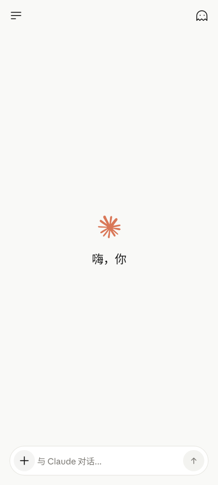
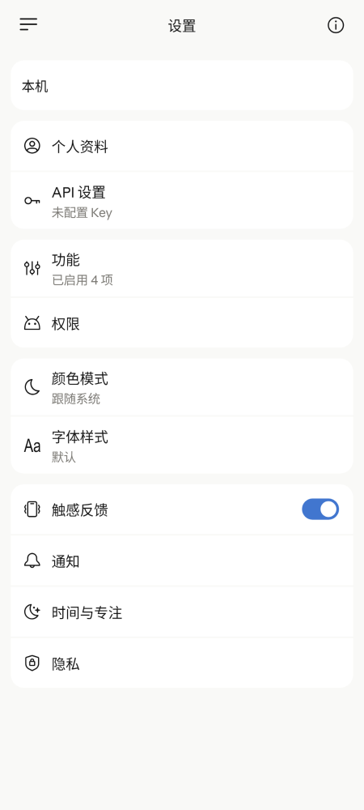
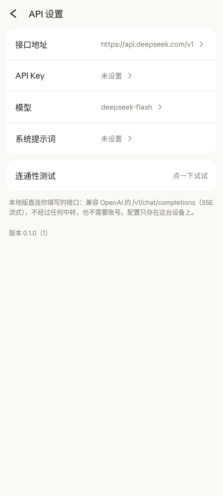
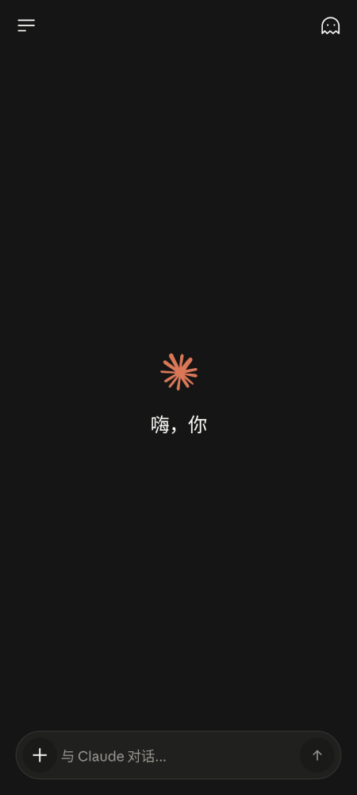

# Claude Android · 本地 API 版

基于 Claude 官方 Android 客户端（`1.261023.20`）的**像素级复刻**，改造成不依赖任何云端服务的本地 API 版：
没有登录、没有账号体系、没有订阅与额度、没有中转服务 —— 模型接口由使用者自己填写，所有数据只存在这台设备上。

> ⚠️ 非官方项目，与 Anthropic 没有任何关联。Claude 名称、界面设计与官方素材的版权归 Anthropic 所有。
> 本项目仅用于学习、研究与个人使用，请勿用于商业分发。

## 截图

| 首页 | 对话 | 设置 | API 设置 |
|---|---|---|---|
|  |  |  |  |

<details>
<summary>深色模式</summary>



</details>

## 特性

- **1:1 复刻的界面**：首页 / 对话 / 抽屉 / 设置 / 个人资料 / 项目 / Artifacts / 记忆 / 权限 / 通知 / 专注页，配色、行高、图标按官方截图逐项量取
- **任意 OpenAI 兼容接口**：`POST {baseUrl}/chat/completions` + SSE 流式，DeepSeek / OpenRouter / Ollama / LM Studio / vLLM 等均可
- **完整的对话体验**：Markdown 渲染、代码块、图片与 PDF 附件、多模态输入、思考中动效、逐字上屏、长回复自动续写
- **本机 Code 页**：模型通过 `ls / read / write / edit / grep` 五个工具直接改手机上的工作区，WebView 预览、多工作区、单文件与整包 zip 导出、生成中前台服务通知
- **本地账户资料**：称呼 / 全名 / 个人偏好 / 头像全部存本机，偏好与称呼会注入系统提示词
- **无账号、无遥测、无第三方 SDK**：不申请任何账号权限，不发起与模型接口无关的请求

## 快速开始

1. 从 [Releases](https://github.com/Nairocy/claude-android-local/releases) 下载 `ClaudeLocal-v0.1.0.apk` 安装（`minSdk 26`）
2. 打开 App → **设置 → API 设置**
3. 填写：
   - 接口地址：`https://api.deepseek.com/v1`（或你的 OpenAI 兼容网关）
   - API Key：你的 Key
   - 模型：`deepseek-chat` / `gpt-4o-mini` / `qwen3-…` 等上游真实模型名
   - 系统提示词：可选
4. 点「连通性测试」确认能通 → 回首页开始对话

> App 内不内置任何 Key，也不代理请求；Key 只保存在本机 `settings.json`。

## 支持的协议

- ✅ OpenAI 兼容 `chat/completions`（流式 SSE、`tool_calls` function calling、多模态 `image_url`）
- ❌ 暂不支持 Anthropic 原生 `/v1/messages`
- 发送请求时不附带 `reasoning_effort` 等厂商私有参数，避免非 DeepSeek 上游 400

## 构建

需要 **JDK 17** 与 **Android SDK 36**（build-tools 36+）：

```bash
# debug
./gradlew assembleDebug

# release（默认用本机 debug keystore 签名，正式分发请换成自己的 keystore）
./gradlew assembleRelease
```

产物：`app/build/outputs/apk/release/app-release.apk`

切换包名 / 版本号：`app/build.gradle.kts` 里的 `applicationId`、`versionCode`、`versionName`。

### 纯 JVM 截图测试

项目用 [Paparazzi](https://github.com/cashapp/paparazzi) 在不需要模拟器的情况下渲染 Compose 界面：

```bash
./gradlew recordPaparazziDebug
# 产物：app/src/test/snapshots/images/
```

当前 **133 个用例**（UI 截图 + 问候语 / 续写策略 / 行 diff / 工作区沙箱等纯逻辑测试）。

## 目录结构

```
app/src/main/java/com/nairocy/claude/
├── MainActivity.kt              // 单 Activity + Screen 路由 / 过渡动画
├── data/                        // 会话、图片、附件、记忆、项目、设置、本地账户
├── net/OpenAiClient.kt          // SSE 流式 + 工具调用 + 自动续写
├── ui/chat/                     // 对话页与 ChatViewModel（进程级单例）
├── ui/code/                     // 本机 Code 页、工具卡、WebView 预览
├── ui/settings/                 // 设置页、API 设置页、个人资料
├── ui/home|drawer|artifacts|…   // 其余页面
└── ui/theme/                    // 颜色、字体、Claude 主题
```

## 本地数据

`Android/data/com.nairocy.claude.local/files/users/local/` 下按类型分目录：

```
users/local/
├── conversations.json   // 会话
├── images/              // 图片
├── attachments/         // 附件
├── workspace/           // Code 页工作区
└── avatar.jpg           // 头像
```

卸载 App 会一并删除；升级安装不丢数据。

## Release 中的两个包

| 文件 | 说明 |
|---|---|
| `ClaudeLocal-v0.1.0.apk` | **本仓库源码构建**，包名 `com.nairocy.claude.local`，本地 API 版，无需账号 |
| `ClaudeCloud-v0.17.11.apk` | 作者自用的**云端账号版**（含账号系统与中转服务），包名 `com.nairocy.claude`，需要账号才能使用；**源码不在本仓库**，仅作界面与交互对照 |

两个包包名不同，可以同时安装。

## 已知限制

- 没有内置联网搜索（需要上游模型自身具备联网能力）
- Code 页依赖模型的 function calling 质量；不支持 function calling 的模型无法驱动文件工具
- 未在所有国产 ROM 上验证后台保活与通知行为
- 多模态输入需要上游支持 `image_url` 内容块

## 贡献

见 [CONTRIBUTING.md](CONTRIBUTING.md)。欢迎 issue / PR，但请先读「有意不做」清单，避免重复讨论。

## 许可证

[MIT](LICENSE) © 2026 Nairocy
